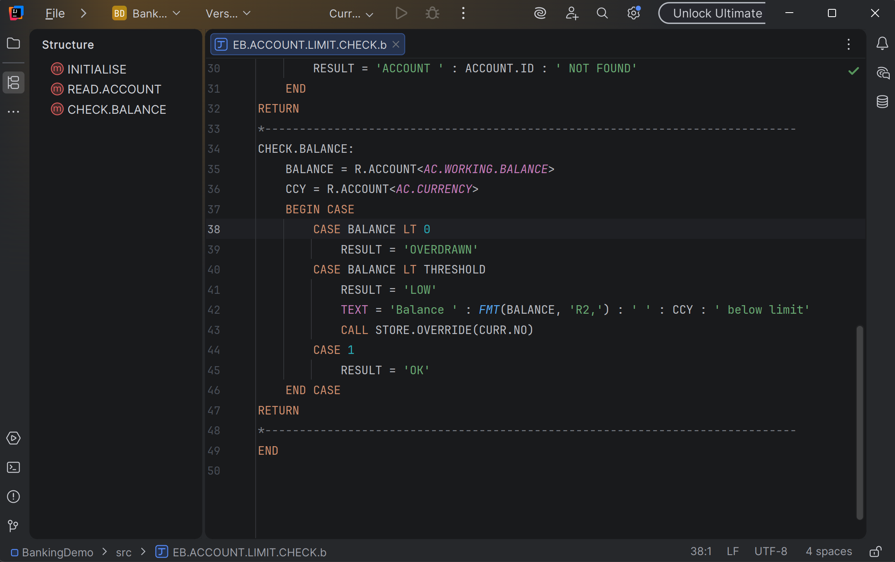
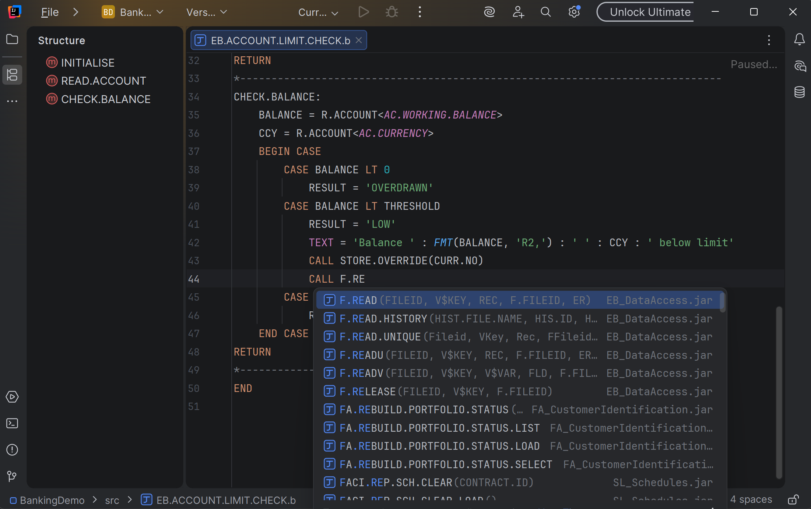
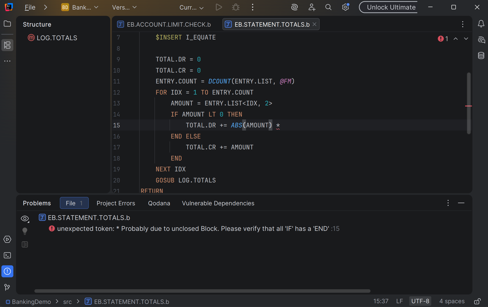
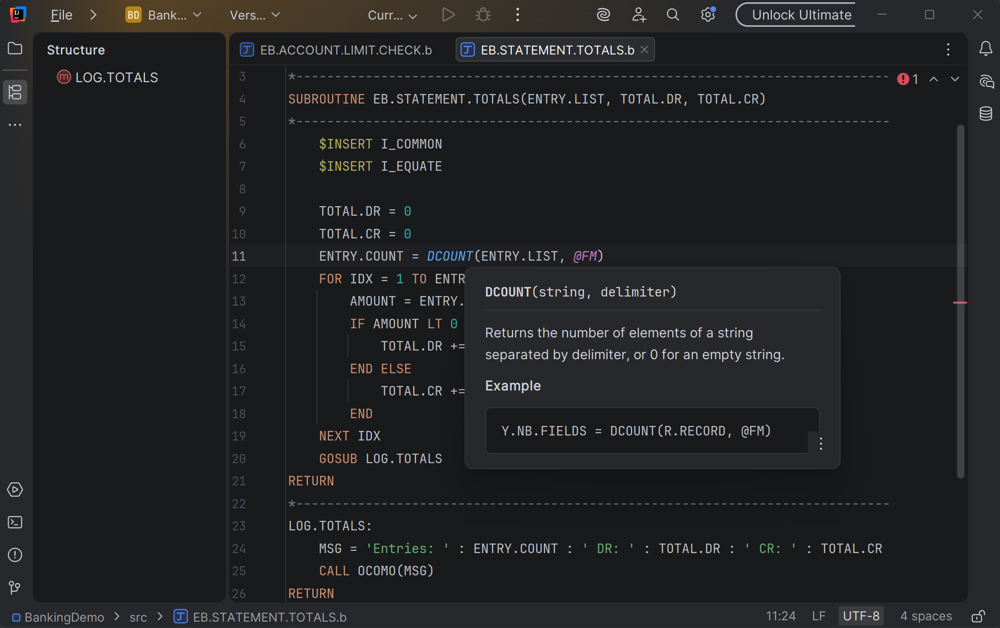
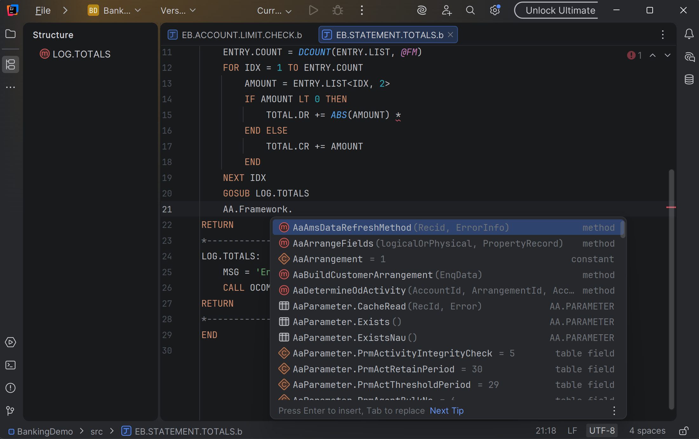

# Core Banking BASIC Tools

IntelliJ IDEA plugin for editing, navigating, compiling and debugging MultiValue BASIC sources (`.b`, `.component`)
on Java-based runtimes such as TAFJ.

This repository holds the plugin's documentation, screenshots, license and issue tracker. The plugin is free; its
source code is not published.

## Features

- BASIC file type for `.b` and `.component` sources
- Syntax highlighting with configurable colors, comment toggling, brace and quote matching
- Labels in the Structure view; Ctrl+Click on `GOSUB` / `GOTO` jumps to the label
- Quick Documentation (Ctrl+Q and hover) for BASIC keywords and built-in functions
- Embedded compiler of the configured runtime: errors highlighted while typing, sources compiled on Build / Rebuild
  Project
- Statement completion: keywords, block statements as templates (`IF … THEN … END`, `FOR … NEXT`,
  `LOOP … REPEAT`, `BEGIN CASE`, `READ`, `LOCATE`, …) and labels after `GOSUB` / `GOTO`
- `CALL` completion with routine parameters read from the compiled libraries; Ctrl+Click on a `CALL` opens the
  routine source or its compiled class
- `$PACKAGE` / `$USING` completion of project and installed components; Ctrl+Click opens the component definition
- Component members: typing a component name and a dot completes its methods (with arguments), constants,
  properties and tables, respecting public / module / private scope
- `$INSERT` completion and navigation; EQU constants and COMMON variables from included inserts are highlighted,
  completed and navigable
- Reformat Code and indentation on Enter in the common house style
- Debugger: compile and debug a program locally, or attach to running application servers (`-Djbc.debug`);
  breakpoints, stepping, variables and dynamic arrays

## Screenshots

| | |
|---|---|
|  |  |
| `CALL` completion with routine parameters | Compiler errors while typing |
|  |  |
| Quick Documentation | Component member completion |

## Installation

1. In IntelliJ IDEA 2025.3 or later, open **Settings | Plugins | Marketplace**, search for
   **Core Banking BASIC Tools** and click **Install**.
2. Add a **TAFJ** facet to your module (**File | Project Structure | Facets**) and set **TAFJ home** to the runtime
   installation (the directory containing `conf/` and `lib/`).

See [Getting started](docs/getting-started.md) for configuration, compilation, debugging, shortcuts and
troubleshooting.

## Requirements

- IntelliJ IDEA 2025.3 or later. Build integration uses the bundled Java plugin; everything else, including the
  debugger, needs only the platform.
- A local runtime installation for compilation, library completion and debugging.

## Feedback

Report bugs and request features in [Issues](https://github.com/DmitryGrec/cbbasic/issues).

## License

Free to use, copy, modify and redistribute under the [Core Banking BASIC Tools License](LICENSE.md). The source code is not
published.

Independent project, not affiliated with or endorsed by the vendors of the supported runtimes. All trademarks belong
to their respective owners.
